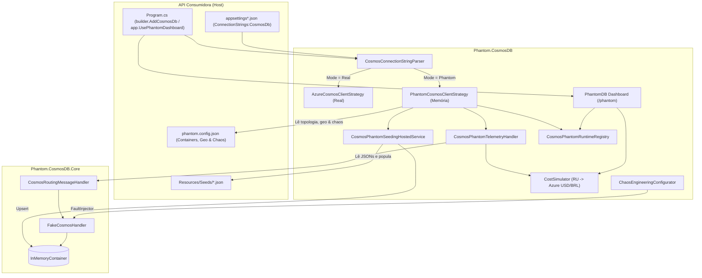
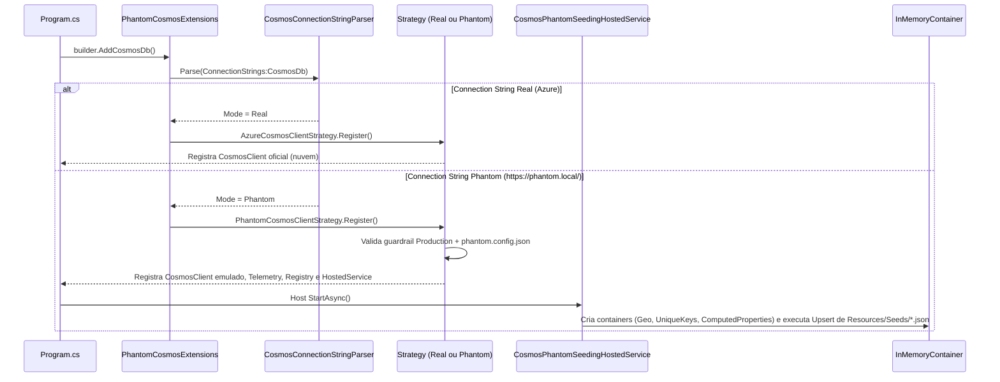
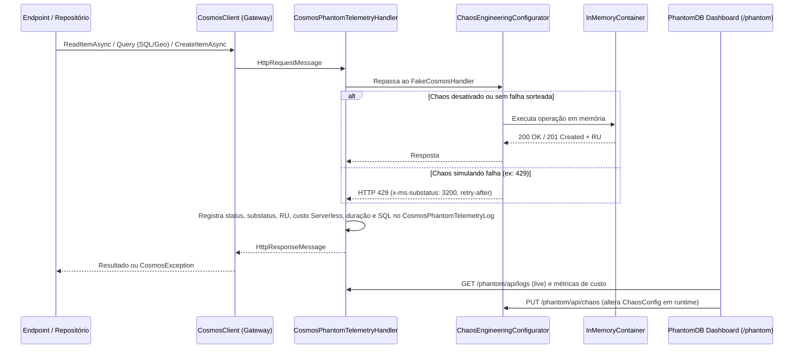

# Arquitetura: Phantom.CosmosDB

Este documento detalha a arquitetura do **Phantom.CosmosDB** em quatro visões: arquitetura em camadas do motor (`Phantom.CosmosDB.Core`), visão geral de componentes, ativação orientada por Connection String e fluxo em runtime (Chaos + Telemetria + Simulador de Custos + PhantomDB Dashboard).

---

## 1. Clean Architecture do Motor (`Phantom.CosmosDB.Core`)

O núcleo em memória segue **Clean Architecture** e **Ports & Adapters (DIP)**, garantidos por *Fitness Functions* automatizadas em `ArchitectureFitnessTests.cs`:

- **`Domain/`**: primitivas (`ETagValue`, `RequestChargeCalculator`, `ContainerConstants`, `CosmosSubStatusCodes`), parsers/validadores puros (`DocumentValidator`, `UniqueKeyValidator`, `JsonParseHelpers`) e contratos de domínio. **Não depende de `Application` nem de `Infrastructure`.**
- **`Application/`**: casos de uso e motor de execução (`Crud`, `Patch`, `Batch`, `ChangeFeed`, `Scripts`, `Account`, `Builders`, `Query/Parsing`, `Query/Evaluation`, `Query/Functions` com `Registry` declarativo e `GeospatialFunctions`). Comunica-se com persistência/SDK exclusivamente por portas em `Application/Contracts/` (`IDocumentStore`, `IChangeFeedLog`, `ISdkResponseMapper`, `IFeedIteratorFactory`, `IDynamicContainerRegistry`, `IGatewayClientFactory`). **Não referencia `Infrastructure`.**
- **`Infrastructure/`**: adaptadores concretos (`Storage/InMemoryItemStore`, `Storage/InMemoryChangeFeedLog`, `HttpGateway/CosmosRoutingMessageHandler`, `GatewayDatabaseLifecycleRouter`, `GatewayContainerLifecycleRouter`, `HybridRowBatchCodec`, `SdkInterop/CosmosResponseFactory`, `FeedIterators/`, `Persistence/`).
- **Raiz (`CorePortDefaults`, `InMemoryContainer` em `partial` files, `FakeCosmosHandler`)**: Composition Root interno e fachada compatível com `Microsoft.Azure.Cosmos.Container`.

### Integração em Soluções Multicamadas (Host vs Demais Camadas)
Em soluções divididas em múltiplos assemblies (`Domain`, `Application`, `Infrastructure`, `Api`/Host):
- **`Domain` / `Application`**: não possuem dependência de `Phantom.CosmosDB`.
- **`Infrastructure` (Repositórios)**: depende apenas de `Microsoft.Azure.Cosmos` e injeta `CosmosClient` normalmente.
- **`Api` (Host / Composition Root)**: instala `Phantom.CosmosDB`, chama `builder.AddCosmosDb()` (ou `services.AddCosmosDb(environment, configuration)` quando o DI está centralizado em um módulo `IoC`) e `app.UsePhantomDashboard()`. O arquivo `phantom.config.json` e `Resources/Seeds/*.json` podem residir no `ContentRootPath` do Host ou na raiz da `.sln`.

---

## 2. Visão Geral de Componentes

---

## 3. Ativação Orientada por Connection String (Sequence Diagram)

---

## 4. Tempo de Execução: Telemetria, Chaos e Dashboard

