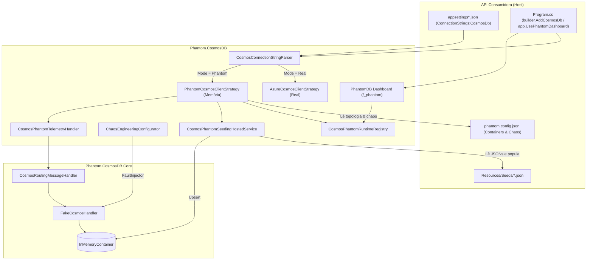
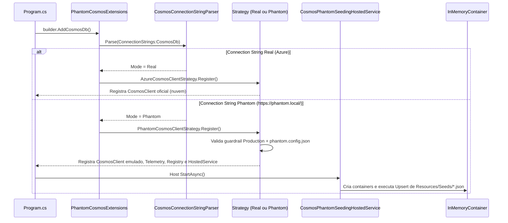
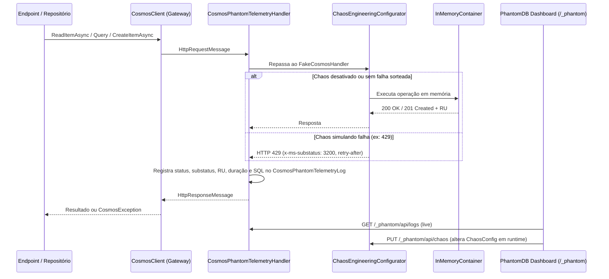

# Arquitetura: Phantom.CosmosDB

Este documento detalha a arquitetura do **Phantom.CosmosDB** em três visões: componentes, ativação orientada por Connection String e fluxo em runtime (Chaos + Telemetria + PhantomDB Dashboard).

---

## 1. Visão Geral de Componentes

---

## 2. Ativação Orientada por Connection String (Sequence Diagram)

---

## 3. Tempo de Execução: Telemetria, Chaos e Dashboard

